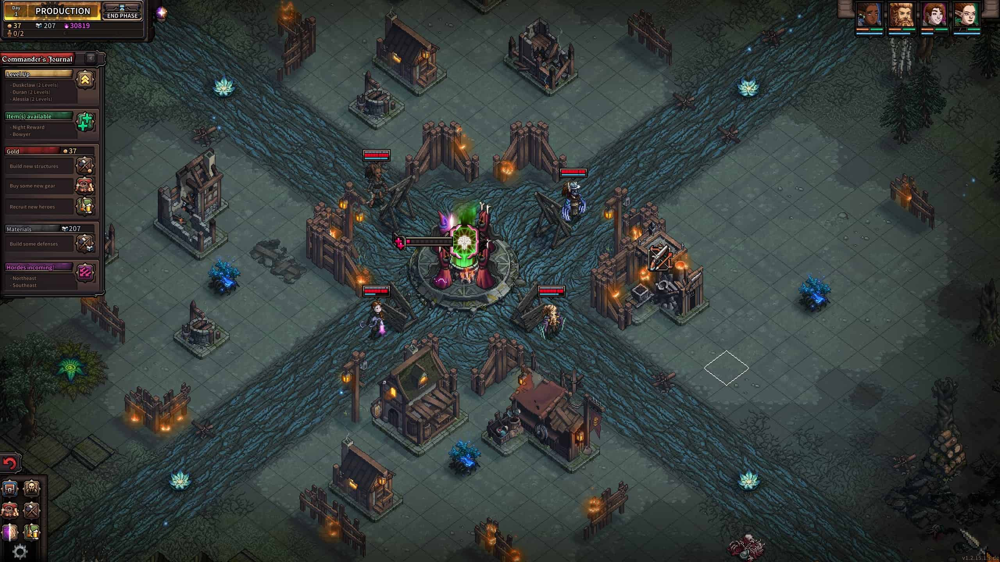
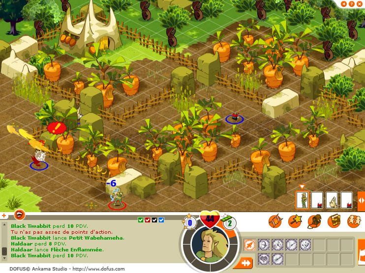

# Game design document one-pager

A work-in-progress tactical strategy game built around turn-based combat, grid-based movement, resource gathering, and map construction.
The project aims to combine tactical decision-making with base building: gather resources, construct defenses and equipment, protect your Nexus, and attack your opponent's.

## Game Identity / Mantra: 
- 3D world with an orthographic camera.
- Grid-based movement and turn-based combat.
- Resource gathering.
- Building structures directly on the map.
- Defend your Nexus and attack your opponent's.

Exemples: 
>  

## Design Pillars:
- **Tactical depth** — Turn-based combat requiring careful positioning, resource management, strategic decisions.
- **Base building and resource management** — Extract resources, construct defenses and equipments.

## Interface: 
In game, The player can interact with a GUI and can select and interact with the game entities with its mouse.
The camera control must be accessible by dragging the mouse out of the window.
> The keyboard is only used for text inputs, handling this device is not needed for the MVP release.

## Art Style: 
To do.
Include references to lots of images and games that have a similar aesthetic to what we're trying to achieve. 
List the emotional responses that it should invoke in the player.

## Music/Sound: 
Same. To do.

## Technical choices
- Implementation of a custom game engine.
- ECS architecture preferred to OOP, whenever its possible.

## Core technologies
- C++23:** Main programming language.
- **CMake:** Build system.
- **Conan:** C++ dependency management.
- **Git and GitHub:** Version control and project management.
- **SDL3:** Window creation, keyboard and mouse input, audio, platform abstraction, OpenGL context.
- **OpenGL:** Graphics rendering.
- **GLAD:** OpenGL function loading.
- **GLM:** Vectors, matrices, transformations, and other graphics mathematics.
- **EnTT:** ECS library; current first choice.
- **stb_image:** Image loading.
- **Assimp:** Importing 3D models and associated data.
- **Dear ImGui:** Create a GUI (buttons and text fields) devs use while debugging the game.
- **spdlog:** Logging.
- **nlohmann/json:** JSON parsing and serialization.
- **SDL_ttf or FreeType:** Font rendering.
- **GoogleTest:** Unit testing.
- **Asio:** Network library for custom TCP/UDP server and client architecture, for online support.

These libraries should be added when they solve actual problems. I do not need to install every dependency at the beginning.

## Development roadmap to the MVP (or v0.1)

### Gameplay 
- The game has a clear and repeatable gameplay loop.
- The entities can be distinguished from one another, from friends to ennemies entities.
- Movement and combat behave consistently.
- The multiplayer is possible, or an AI has been implemented.
- The player can benefit from all the "Design Pillars".
- The player can win or lose an encounter.

### Build
- Major known crashes and blocking bugs have been addressed.
- The game can be built and packaged for Windows.
- The packaged build has been tested independently of the development environment.
- The game can be installed using an installer, without requiring any manual commands.
- The repository documents how to build and run the project.